# Plan implementation of the safety decision models benchmark

## Remember
- Exact file paths always
- Exact commands with expected output
- DRY, YAGNI, TDD, frequent commits
- Delegated tasks must be impossible to misread.

## Overview

This plan describes a later implementation of the standalone study in `docs/plans/2026-10-19_safety-decision-model-benchmark_a7c3e1/proposal.md`. The work lives under `experiments/safety_decision_models_2026_10_19/` with its own `pyproject.toml`, outside the root uv workspace. Four arms score the core pack: Jev (`jev-1.13.0`), Clef, Clef-flash, and Bedrock Guardrails via `ApplyGuardrail` in `us-east-2`. Datasets are ToxiGen, OpenAI Moderation, ToxicChat, prompt injections (`deepset/prompt-injections`), WildGuardMix, Do-Not-Answer, XSTest, HarmBench, JailbreakBench, GoEmotions, and `dair-ai/emotion`. Stack policies (union, intersection, cascade) read saved predictions only. Planning budget for the required arms on the core pack is under US$50.

## Happy flow

The implementer loads pinned Hugging Face rows and confirms one template per dataset. They pass smoke and Jev harness checks, create the guardrail and crosswalk, and score every arm through the cache. They then fit thresholds, write metrics and eight figures, and upload artifacts to S3 while omitting Do-Not-Answer question text.

```mermaid
flowchart LR
  proposal[proposal.md] --> scaffold[experiments/safety_decision_models_2026_10_19]
  scaffold --> templates[data/templates]
  templates --> smoke[scripts/smoke.py]
  smoke --> harness[Jev harness check]
  harness --> guardrail[guardrails + crosswalk]
  guardrail --> score[run_score.py + cache]
  score --> metrics[run_metrics.py]
  metrics --> s3[scripts/upload_s3.py]
```

## Approach

Follow proposal sections 4, 5, 9, and 10 and the approved layout in Review points (2026-10-20). Reuse patterns from `experiments/moral_outrage_classification_2026_09_19/` and `experiments/speedup_jev_2026_09_23/` for secrets, rate limits, cache keys, and S3 upload. Align overlapping question wording with the public harness at https://github.com/AppliedMachineLearning-Lab/jev-benchmarking without vendoring it. Correctness is checked with `experiments/safety_decision_models_2026_10_19/scripts/smoke.py` and harness intervals in `RESULTS.md`. The approved proposal forbids unit tests, so this study does not add a `tests/` directory or pytest suite.

## Steps

### Step 1: Scaffold experiment folder, loaders, and shared scorer

Create `experiments/safety_decision_models_2026_10_19/` from the approved tree in proposal section 5: `datasets/`, `scorers/`, `policies/`, `shared/`, `data/templates/`, `configs/study.json`, `cache/`, `scripts/`, and `outputs/` layout. Implement dataset loaders and the shared scorer method from proposal section 4, including XSTest prompt dedupe on `allenai/xstest-response`, HarmBench configs `DirectRequest` and `HumanJailbreaks`, JailbreakBench `harmful` and `benign` splits on `JailbreakBench/JBB-Behaviors`, and `hf-token` for gated datasets. On the first successful load, pin each dataset revision to that commit in `outputs/manifests/{run_id}.json` and refuse a later load whose commit differs. Add a standalone `pyproject.toml` (not listed under root uv workspace members, which stay `autoresearch/*`). Add `experiments/safety_decision_models_2026_10_19` to the same root `pyproject.toml` exclude entries as `experiments/moral_outrage_classification_2026_09_19` for ruff and pyright. Do not create a `tests/` directory.

Proposal mapping: section 4, section 5, section 10 step 1.

### Step 2: Confirm one template per dataset

On 20 development items per dataset, confirm one question template. For the six overlapping sets with the public harness, start from the `build` methods in `jev_benchmarking/tasks/safety.py` and `jev_benchmarking/tasks/classification.py` (harness not vendored). Write JSON to `experiments/safety_decision_models_2026_10_19/data/templates/{dataset}.json`. Template version is a hash of that file. Before any edit, archive the prior file at `data/templates/archive/{dataset}/{template_version}.json`. Templates hold the question spec only, never dataset rows. Do-Not-Answer question text is never committed.

Proposal mapping: section 4, section 5, section 10 step 2.

### Step 3: Run the 20-item smoke test

Implement the Step 1 stub in `experiments/safety_decision_models_2026_10_19/scripts/smoke.py` and run it on 20 development items, end to end. In Step 3, run arms `jev`, `clef`, and `clef-flash` first; re-run the same script for arm `guardrails` after Step 5 creates the numbered guardrail. Stop if any probability or band is empty, if a rerun misses the cache in `cache/responses.db`, or if the Jev smoke metric cannot be compared with the published harness metric.

Proposal mapping: section 4, section 5, section 10 step 3.

### Step 4: Jev harness check on six overlapping sets

Run Jev `jev-1.13.0` on ToxiGen, OpenAI Moderation, ToxicChat, prompt injections, GoEmotions, and Emotion. Compare primary metrics to the published intervals in proposal section 3. For OpenAI Moderation, score all 1,680 rows at threshold 0.5. Stop if any primary metric falls outside its published interval. Record harness-check numbers in `experiments/safety_decision_models_2026_10_19/RESULTS.md`.

Proposal mapping: section 3, section 5, section 10 step 4.

### Step 5: Create guardrail and publish crosswalk

Create one numbered guardrail in `us-east-2` with the six content filters (Hate, Insults, Sexual, Violence, Misconduct, Prompt Attack) and filter action `NONE`. Write the dataset-label-to-filter crosswalk into `experiments/safety_decision_models_2026_10_19/configs/study.json` (committed; no separate crosswalk file) before any test score from the full pack. The crosswalk does not use harness-check numbers from step 4. Create three numbered guardrail versions only if detect mode omits the band. Store the guardrail version id in the run manifest and re-run `scripts/smoke.py` for arm `guardrails`.

Proposal mapping: section 4, section 6, Decisions made item 1, section 10 step 5.

### Step 6: Score the core pack through the cache

Score all core-pack rows with Jev, Clef, Clef-flash, and `ApplyGuardrail` via `experiments/safety_decision_models_2026_10_19/scripts/run_score.py`, writing `outputs/predictions/{run_id}/{arm}/{dataset}.parquet` and `.jsonl` and using `cache/responses.db`. Do not upload to S3 in this step (Step 7). Clef request body uses fields `model`, `state`, and `questions` as an object keyed by question id (not a list). Workers AI shortens an over-limit `state` and still returns an answer. Mark those rows `truncated` (Clef 64,000 tokens, Clef-flash 24,576 tokens). Jev still records provider error `max_tokens_exceeded` for context overflow.

Proposal mapping: section 4, section 5, Decisions made item 7, section 10 step 6.

### Step 7: Fit thresholds, metrics, figures, and S3 upload

Fit thresholds on development splits. For OpenAI Moderation, fit the tuned threshold on the hash-stable 20% holdout and exclude that holdout from the tuned test number. Sets under 200 labeled development items (prompt injections, JailbreakBench) stay at threshold 0.5. Compute metrics and the eight figures from proposal section 7. Write `outputs/metrics/{run_id}.json`, `outputs/figures/{run_id}/*.png`, and `outputs/manifests/{run_id}.json` with `run_id` form `{YYYYMMDD}T{HHMMSS}Z_{8 hex characters}`. Upload with `experiments/safety_decision_models_2026_10_19/scripts/upload_s3.py` to `s3://mind-technology-lab-experiments/experiments/safety_decision_models_2026_10_19/`, skipping Do-Not-Answer question text (snapshot, records, and cache entries that hold the text). Aggregates by risk area and type of harm still upload inside the metrics file.

Proposal mapping: section 5, section 6, section 7, Decisions made item 6, section 10 step 7.

**Dependencies**

- Step 1 has no code dependency. It reads the proposal.
- Step 2 depends on step 1.
- Step 3 depends on steps 1 and 2.
- Step 4 depends on step 3.
- Step 5 depends on step 1 for the guardrail module; live guardrail creation happens after step 4 so the crosswalk is written before test scores from the full pack. The crosswalk does not use step 4 numbers.
- Step 6 depends on steps 3 and 5.
- Step 7 depends on step 6.

**Inputs and outputs (owner: implementer for every step)**

| Step | Inputs | Outputs |
| --- | --- | --- |
| 1 | Proposal section 5 tree | `experiments/safety_decision_models_2026_10_19/` folder, loaders, scorer modules, `.gitignore`, `pyproject.toml`, `README.md`, `SETUP.md`, `RESULTS.md` stub |
| 2 | Development rows; harness `build` methods | `experiments/safety_decision_models_2026_10_19/data/templates/{dataset}.json` |
| 3 | Templates; 20 development items | Smoke log; no new committed predictions |
| 4 | Six overlapping datasets | Harness-check numbers in `experiments/safety_decision_models_2026_10_19/RESULTS.md`; stop if outside published interval |
| 5 | Six filter names | Guardrail version id in manifest; committed `crosswalk` in `configs/study.json` |
| 6 | Core pack rows | `outputs/predictions/{run_id}/{arm}/{dataset}.parquet`, `.jsonl`; `cache/responses.db` |
| 7 | Prediction files | `outputs/metrics/{run_id}.json`, `outputs/figures/{run_id}/*.png`, `outputs/manifests/{run_id}.json`; S3 prefix `s3://mind-technology-lab-experiments/experiments/safety_decision_models_2026_10_19/` |

**Secrets (never committed, region `us-east-2`)**

- `jev-typesafe-api-key` (JSON field `TYPESAFE_API_KEY`)
- `hf-token`
- `cloudflare-workers-ai` (JSON fields `account_id` and `api_token`)
- AWS via `LAB_AWS_ACCESS_KEY_ID` and `LAB_AWS_ACCESS_KEY_SECRET`

## What "done" looks like

1. `experiments/safety_decision_models_2026_10_19/` matches the approved section 5 tree, is excluded from root ruff and pyright like `experiments/moral_outrage_classification_2026_09_19/`, and has no `tests/` directory.
2. All eleven dataset loaders pin revisions on first load and refuse mismatched commits; gated data uses `hf-token`.
3. One confirmed template per dataset lives under `data/templates/{dataset}.json` with archives under `data/templates/archive/`; Do-Not-Answer question text is absent from git.
4. `scripts/smoke.py` passes for Jev, Clef, Clef-flash, and Guardrails on 20 development items with cache hit on rerun.
5. Jev `jev-1.13.0` harness-check metrics for the six overlapping sets sit inside published intervals in `RESULTS.md`, including OpenAI Moderation at 0.5 on all 1,680 rows.
6. A numbered guardrail exists in `us-east-2`; the crosswalk in `configs/study.json` was fixed before full-pack test scores; manifest records the guardrail version id; guardrails smoke passed after Step 5.
7. Core-pack predictions exist under `outputs/predictions/{run_id}/` for arms `jev`, `clef`, `clef-flash`, and `guardrails`; truncated Clef rows are marked; Jev overflow rows record `max_tokens_exceeded`.
8. `outputs/metrics/{run_id}.json` includes stack policy numbers; eight figure PNGs sit under `outputs/figures/{run_id}/`.
9. `outputs/manifests/{run_id}.json` records dataset commits, template versions, arms, prices, and region.
10. S3 upload at `s3://mind-technology-lab-experiments/experiments/safety_decision_models_2026_10_19/` omits Do-Not-Answer question text while uploading aggregates by risk area and type of harm.

This plan does not add the experiment folder. Implementation is a later change.
