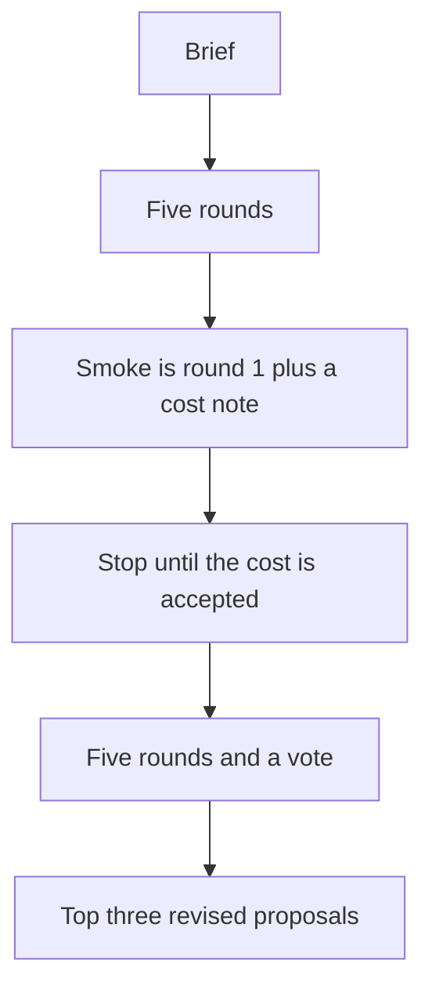

# Add the social science idea-generation workflow

## Remember

- Exact file paths always
- Exact commands with expected output
- DRY, YAGNI, TDD, frequent commits
- Delegated tasks must be impossible to misread.

## Overview

[proposal.md](proposal.md) is the settled design for [issue 35](https://github.com/METResearchGroup/mind_technology_lab_experiments/issues/35). The seven decisions there are confirmed. Decision 6 reads both API keys through `lib/load_env_vars.py`.

The work adds one experiment that runs five discussion rounds and returns three revised research ideas, plus two allowlist rows in the existing env loader. A one-round smoke run writes a cost note and stops. The five-round run waits until that cost is accepted. The plan adds no pytest files, no `tests/` paths, and no `test_*.py` files. The smoke script is the check.

## Happy flow

You start from one brief. Each round begins with a different disciplinary agent, the other four comment twice, and a synthesizer, a methodologist, and a critic produce one revised proposal. After five rounds, seven agents score the revisions and you keep the top three, with the turn log, one LangSmith thread per round, and a sixth thread for the vote.

## Approach

Keep the stage order in a Python driver so a free parent agent cannot skip a speaker. Each turn is its own Deep Agents call, with delegation and filesystem tools off. Read keys only through the existing allowlist in `lib/load_env_vars.py`, using the same row shape as the GitHub token row already in that file. The experiment package is `workflow`, so it does not hide repository `shared.aws`. Save the round record as JSON, upload it to the experiment prefix in S3, and price the full run from the smoke round before anyone launches the other four rounds.

The four steps match the four steps in the proposal. Step 2 changed only in where the keys are read. The experiment calls the allowlist in `lib/load_env_vars.py`.

## Steps

### Step 1: Add the experiment records and role prompts

Create the experiment package, the records, the role prompts, and the committed brief. Do not call a model. See [steps/step1.md](steps/step1.md).

### Step 2: Connect keys, the model, and LangSmith

Add the OpenAI and LangSmith rows to the allowlist in `lib/load_env_vars.py`, then build the chat model and the tracer from those values. Do not call the model. See [steps/step2.md](steps/step2.md).

### Step 3: Run one round and estimate the cost of five rounds

Run round 1, write the cost note, upload the smoke files, and stop. See [steps/step3.md](steps/step3.md).

### Step 4: Run five rounds and rank them

Write the five-round runner and the vote. Do not launch that run until the smoke cost is accepted. See [steps/step4.md](steps/step4.md).

## What "done" looks like

1. `experiments/social_science_idea_generation_2026_10_21/` holds the driver, the brief, and a stub `RESULTS.md`.
2. `lib/load_env_vars.py` can return the OpenAI key and the LangSmith key by name, and the experiment does not contain its own secret client.
3. The smoke run writes one round record and one cost note under the smoke prefix, and it does not continue into rounds 2 through 5.
4. After the cost is accepted, the full run writes the top three proposals and the turn log, and it uploads them under the runs prefix.
5. No new pytest file exists for this work.
