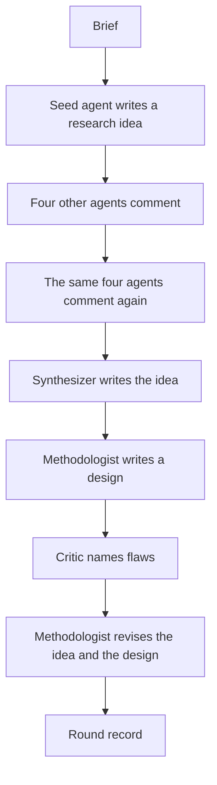
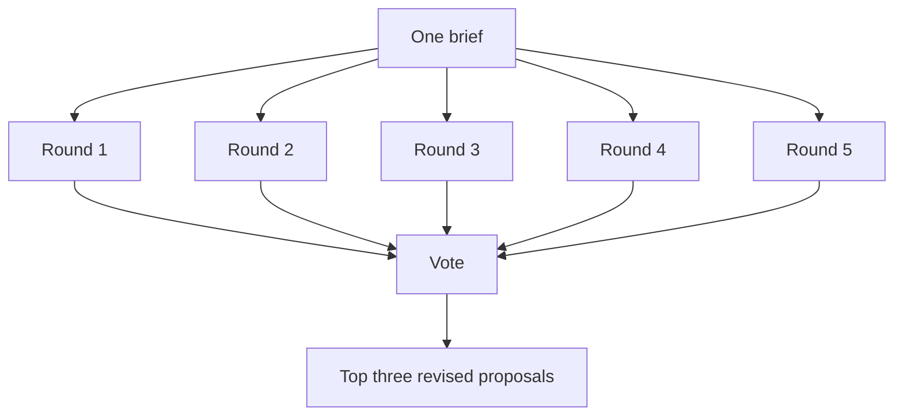
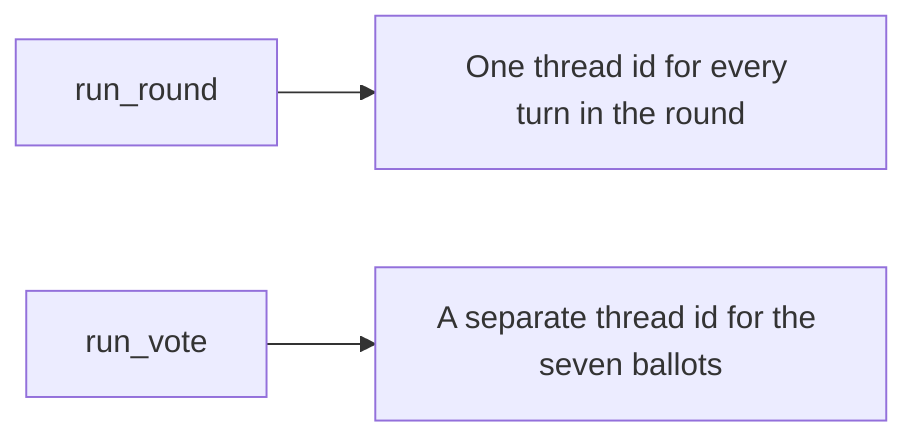

# Proposal: A workflow that returns three social science research ideas

Scope: [issue 35](https://github.com/METResearchGroup/mind_technology_lab_experiments/issues/35). The proposal covers the agent workflow, the files, the saved records, and the cost estimate from the smoke run. The decisions at the end are confirmed. You decide whether an idea is good, feasible, or non-obvious.

## Overview

Issue 35 asks for a structured discussion that produces a few social science ideas for people to assess. You run a Python driver for five rounds. In each round a different disciplinary agent proposes an idea, and the other four comment twice. A synthesizer then writes the idea in one place, and a methodologist writes a design. A critic looks for a fatal flaw, and the methodologist revises. After the five rounds, seven agents score the revised proposals, and you keep the top three.

You get the top three revised proposals in `RESULTS.md`, and you get the full turn log as JSON. You also get one LangSmith thread per round, so you can read how an idea changed. The agents have no search tool, so they cannot check prior work. Billy's comment in the issue says there is no reliable way to verify a social science idea at scale, and you judge the three proposals yourself.

## Cross-cutting concerns

### The Python driver keeps the stage order

The issue asks for LangChain Deep Agents (`deepagents`). In the current docs, `create_deep_agent` builds an agent that uses tools and can delegate to subagents on its own, so a single parent agent could skip a stage. `src/run_round.py` keeps the stage order fixed, and each turn is a separate `create_deep_agent` run.

You pass `tools=[]`, and `create_deep_agent` still keeps the built-in filesystem tools. An empty tools list removes domain tools only. `build_role_agent` registers a `HarnessProfile` for `openai:gpt-6-sol` with `general_purpose_subagent` disabled and with `ls`, `read_file`, `write_file`, `edit_file`, `delete`, `glob`, and `grep` excluded. The profile fields match the `deepagents` 0.7 documentation. You leave skills, memory files, a sandbox, and a todo list off, because `src/run_round.py` already chooses the next turn. `response_format` is the Pydantic model for the turn, and the system prompt is the persona file `load_prompt` reads.

`build_chat_model` returns `ChatOpenAI(model="gpt-6-sol", use_responses_api=True, reasoning={"effort": "medium"})`, with output capped at 25,000 tokens. The model page says to use the Responses API for tool calling, because Chat Completions can tool-call `gpt-6-sol` only when reasoning effort is `none`. Setting `reasoning` also routes `ChatOpenAI` to the Responses API. `reasoning.mode` stays at the default, `standard`.

### Model, price, and keys

The model id is `gpt-6-sol`. On 2026-10-21 the model page listed a 1,050,000 token context window. Standard prices for the short context are $2 per 1M input tokens, $0.20 per 1M cached input tokens, and $10 per 1M output tokens. OpenAI charges twice the input rate and 1.5 times the output rate, for the whole request, when a prompt is above 272,000 input tokens. The OpenAI reasoning guide says reasoning tokens are billed as output tokens, and the guide recommends reserving at least 25,000 tokens for reasoning and visible output when you first use a reasoning model. The output cap is the 25,000 token reserve in the OpenAI reasoning guide.

The OpenAI key is secret `openai-api-key`, JSON field `OPENAI_API_KEY`, in `us-east-2`. The field name is the constant `SECRET_KEY` in `cookbooks/how_to_use_aws_secrets_manager/main.py`. The LangSmith key is secret `langsmith-api-key`, JSON field `LANGSMITH_API_KEY`, in the same region. The secret values were not read.

`lib/load_env_vars.py` `EnvVarsContainer.get_env_var` is the only key read. `ALLOWLIST` already maps `GITHUB_PAT_TOKEN` to secret `github-pat-token` and field `GH_TOKEN`. The same row shape gains `OPENAI_API_KEY` and `LANGSMITH_API_KEY`. `_initialize_env_vars` still calls `shared.aws.secretsmanager.secrets_manager_client` and `load_secret_field`. The experiment does not call those two functions, and it does not build its own client. The region stays `shared.aws.constants.DEFAULT_REGION_NAME`, which is `us-east-2`.

Call sites pass `required=True`. A missing or empty value raises `ValueError`, and the message does not include the secret value. The module docstring keeps a length-only check. Do not print the key. Scripts run with the repository root on `PYTHONPATH`, and `uv run` uses the experiment `pyproject.toml`, so `from lib.load_env_vars import EnvVarsContainer` resolves in the experiment environment.

### Who speaks, and what each agent reads

The five disciplinary roles, in seed order, are:

- a social psychologist working on computational social science
- a computer scientist working on measurement from digital traces
- a communications researcher working on online discourse
- a sociologist working on networks and inequality
- a political scientist working on political behavior

Round 1 starts with the social psychologist, and round 5 starts with the political scientist. The seed agent does not comment on its own idea. The other four comment twice, in a fixed rotation that starts with the role after the seed.

The synthesizer, the methodologist, and the critic are separate from the five disciplinary roles, because the issue treats the restatement, the design, and the critique as separate jobs. The synthesizer restates the discussion, and the methodologist writes and revises the design. The critic looks for flaws. Each system prompt includes the rules in the list:

- Stay in the assigned job.
- Return only the schema.
- If you mention a prior study, say it was not checked. Do not invent a citation.

You do not pass an earlier round's idea into a later round. The rounds share the brief, and they meet again only in the vote.

| Turn | Text the agent receives |
| --- | --- |
| Seed | The brief only. |
| Comment | The brief, the seed idea, and the earlier comments in that round. |
| Synthesizer | The brief and every turn so far in that round. |
| Method, first pass | The brief and the synthesized idea. |
| Critique | The brief, the synthesized idea, and the method. |
| Revision | The brief, the synthesized idea, the method, and the critique. |
| Ballot | The brief and the five revised proposals. No transcript. |





### Tracing

LangSmith keeps every turn of a round in one thread, so you can read the discussion without opening the JSON. `configure_tracing` sets `LANGSMITH_TRACING` to `true`, sets `LANGSMITH_API_KEY`, and sets `LANGSMITH_PROJECT` to `social-science-idea-generation` before any model call. `run_round` assigns one thread id from `langsmith.uuid7`. `run_vote` assigns a sixth thread id. `run_turn` passes that id as `metadata.thread_id` on the graph run, including child runs, because the LangSmith thread docs say token totals omit child runs that lack the id.



### Storage

The traces are for reading a round. The JSON files are the record `run_vote` and `estimate_full_run_cost` read. Local JSON under `outputs/` is gitignored. You upload the same tree from `run_smoke` and `run_study` with `shared.aws.s3.S3.upload_file` to bucket `mind-technology-lab-experiments`. The prefix matches the experiment folder, which is the storage rule in `AGENTS.md`.

Root `shared/` does not import the new experiment. The new experiment does not import `experiments/speedup_jev_2026_09_23`. The new experiment does not change root `shared/` or any other experiment. It does add the two allowlist rows in `lib/load_env_vars.py`. The driver loads each prompt from `workflow/prompts/` for the call. Python source does not contain the prompt text. You write the JSON in the scripts and upload the files.

### Dependencies

The experiment has its own `pyproject.toml` and is not a uv workspace member. Root workspace members are only `autoresearch/*`, and the root environment is for repo tooling. The experiment depends on `deepagents`, `langchain` with the OpenAI extra, `langsmith`, `pydantic`, `boto3`, and `tiktoken`. Step 3 adds `tiktoken` so the ballot prompt can be counted with encoding `o200k_base`. You pin the versions when you run `uv add`, to the releases current then. The root `pyproject.toml` stays unchanged.

## File structure

The driver needs the files in the repository tree and the S3 tree. The other experiment folders stay as they are. The experiment package is `workflow`, because a directory named `shared` would collide with repository `shared.aws` when both are on `PYTHONPATH`.

### Repository

```text
docs/plans/2026-10-21_social-science-idea-generation_d9ac12/
  proposal.md            this proposal

lib/load_env_vars.py     two new ALLOWLIST rows, beside the GitHub token row

experiments/social_science_idea_generation_2026_10_21/
  README.md              the three mermaid diagrams, plus how to run the smoke
  SETUP.md               allowlist names, region, model id, LangSmith project
  RESULTS.md             stub until a full run, then the top three proposals
  pyproject.toml         experiment dependencies, not root
  uv.lock                pins written by uv add
  .gitignore             outputs/**/*.json
  inputs/brief.md        the committed brief
  workflow/__init__.py     package marker
  workflow/constants.py    model id, prices, S3 names
  workflow/schemas.py      Pydantic records, including TurnKind
  workflow/roles.py        RoleSpec and ROLE_ORDER, prompts loaded from files
  workflow/prompts/__init__.py   load_prompt, no prompt text
  workflow/prompts/personas/<role_id>.md
  workflow/prompts/templates/<turn_kind>.md
  workflow/tracing.py      configure_tracing
  workflow/agents.py       ChatOpenAI, create_deep_agent
  workflow/cost.py         estimate_full_run_cost
  src/__init__.py          package marker for python -m
  src/run_round.py       one round
  src/run_smoke.py       round 1, then the cost estimate
  src/run_study.py       five rounds, run_vote, RESULTS.md, S3 upload
```

### S3

```text
s3://mind-technology-lab-experiments/experiments/social_science_idea_generation_2026_10_21/
  smoke/<run_id>/round.json
  smoke/<run_id>/cost.json
  runs/<run_id>/study.json
  runs/<run_id>/RESULTS.md
```

## Schema and key interfaces

The records are the objects the driver writes. `run_vote` and `estimate_full_run_cost` read the same objects, so the table lists the fields a round has to keep.

| Model | Lives in | Role |
| --- | --- | --- |
| `RoleSpec` | `workflow/roles.py` (new) | `role_id`, `display_name`, `system_prompt`. `system_prompt` is the text `load_prompt` reads from `workflow/prompts/personas/<role_id>.md`. |
| `ResearchIdea` | `workflow/schemas.py` (new) | Seed and synthesizer output. Fields: `title`, `question`, `claim`, `population`, `outcome`, `why_it_might_be_nonobvious`. |
| `Comment` | `workflow/schemas.py` (new) | One comment. Fields: `objection`, `alternative`. |
| `MethodPlan` | `workflow/schemas.py` (new) | First method pass. Fields: `design`, `data`, `comparison`, `main_threat`. |
| `Critique` | `workflow/schemas.py` (new) | Fields: `fatal` (bool), `flaws` (list of strings), `required_change`. |
| `RevisedProposal` | `workflow/schemas.py` (new) | Revision turn. Fields: `idea` (`ResearchIdea`), `method` (`MethodPlan`), `what_changed`. |
| `CriterionScore` | `workflow/schemas.py` (new) | One proposal's scores. Fields: `round_index`, `non_obvious`, `feasible`, `method_fits_question`. Each score is an int from 1 to 5. |
| `Ballot` | `workflow/schemas.py` (new) | Fields: `voter`, `scores` (five `CriterionScore` rows), `input_tokens`, `output_tokens`, `reasoning_tokens`. The score total is the sum of the three scores, computed in code. Token fields come from that ballot's model call. |
| `TurnKind` | `workflow/schemas.py` (new) | String enum: `seed`, `comment`, `synthesis`, `method`, `critique`, `revision`, `ballot`. |
| `TurnRecord` | `workflow/schemas.py` (new) | One model call. Fields: `role`, `kind` (`TurnKind`), `iteration`, `payload`, `input_tokens`, `output_tokens`, `reasoning_tokens`, `latency_ms`. Stored. |
| `RoundRecord` | `workflow/schemas.py` (new) | Fields: `round_index`, `seed_role`, `thread_id`, `brief_sha256`, `turns`. Stored. The revision turn holds the `RevisedProposal`. |
| `VoteRecord` | `workflow/schemas.py` (new) | Fields: `thread_id`, `ballots`, `ranking` (round indexes, best first), `top_three`. Stored. |
| `StudyResult` | `workflow/schemas.py` (new) | Fields: `run_id`, `model_id`, `reasoning_effort`, `brief_sha256`, `rounds`, `vote`, `total_input_tokens`, `total_output_tokens`. Stored as `study.json`. |
| `CostEstimate` | `workflow/cost.py` (new) | Fields: `full_input_tokens`, `full_output_tokens`, `estimated_cost_usd`, `price_page_url`, `note`. Stored as smoke `cost.json`. |

You sort `ranking` by mean score total, higher first. A tie uses the higher mean `feasible` score, then the lower `round_index`.

`lib/load_env_vars.py` keeps the GitHub row and adds the two rows in the allowlist block. Call sites use `EnvVarsContainer.get_env_var(name, required=True)`.

```python
ALLOWLIST: Final[dict[str, tuple[str, str]]] = {
    "GITHUB_PAT_TOKEN": ("github-pat-token", "GH_TOKEN"),
    "OPENAI_API_KEY": ("openai-api-key", "OPENAI_API_KEY"),
    "LANGSMITH_API_KEY": ("langsmith-api-key", "LANGSMITH_API_KEY"),
}
```

```python
def load_prompt(relative_path: str) -> str: ...


def configure_tracing(langsmith_api_key: str) -> None: ...


def build_chat_model(api_key: str) -> ChatOpenAI: ...


def build_role_agent(
    role: RoleSpec,
    response_model: type[BaseModel],
    chat_model: ChatOpenAI,
) -> CompiledStateGraph: ...


def transcript_for(kind: TurnKind, brief: str, turns: list[TurnRecord]) -> str: ...


def run_turn(
    role: RoleSpec,
    kind: TurnKind,
    response_model: type[BaseModel],
    transcript: str,
    thread_id: str,
    chat_model: ChatOpenAI,
) -> TurnRecord: ...


def revised_proposal(round_record: RoundRecord) -> RevisedProposal: ...


def run_round(round_index: int, brief: str, run_id: str) -> RoundRecord: ...


def run_vote(rounds: list[RoundRecord], run_id: str) -> VoteRecord: ...


def run_smoke(brief_path: Path, run_id: str) -> CostEstimate: ...


def estimate_full_run_cost(round_record: RoundRecord) -> CostEstimate: ...


def run_study(brief_path: Path, run_id: str) -> StudyResult: ...
```

`workflow/constants.py` holds the fixed values.

```python
MODEL_ID = "gpt-6-sol"
REASONING_EFFORT = "medium"
MAX_OUTPUT_TOKENS = 25_000
LANGSMITH_PROJECT = "social-science-idea-generation"
S3_BUCKET = "mind-technology-lab-experiments"
EXPERIMENT_NAME = "social_science_idea_generation_2026_10_21"
DISCUSSION_ITERATIONS = 2
INPUT_USD_PER_MILLION = 2.0
OUTPUT_USD_PER_MILLION = 10.0
PRICE_PAGE_URL = "https://developers.openai.com/api/docs/models/gpt-6-sol"
```

You retry a parse failure once inside `run_turn`. A second failure stops the current round, and you do not fill in a missing proposal in `run_study`. A turn that calls a tool fails the same way, because the tool list is supposed to be empty.

The committed brief in `inputs/brief.md` is for the smoke run, and for any full run you launch before you replace the file. The full text is under Prompts.

## Prompts

You can read every prompt in this section before a run. Step 1 copies each fenced block into the file named in the heading. `load_prompt` in `workflow/prompts/__init__.py` reads that UTF-8 file from `workflow/prompts/`. A path that leaves that directory raises `ValueError`, and a missing file raises `FileNotFoundError`. Python source does not contain these strings.

The system message is the persona file. The user message is the turn template after the driver replaces the placeholders. The driver does not add any other instruction.

### Placeholders

The driver replaces each token with `str.replace`. A remaining `{{` raises `ValueError`.

| Token | Filled with |
| --- | --- |
| `{{brief}}` | Full text of `inputs/brief.md`. |
| `{{seed_idea}}` | JSON for the seed `ResearchIdea`. |
| `{{prior_comments}}` | JSON for earlier `Comment` payloads in the round, or the words `none yet` when that list is empty. |
| `{{iteration}}` | `1` or `2`. |
| `{{discussion_iterations}}` | `2`. |
| `{{discussion}}` | JSON for every turn so far in the round, in order, with `role` and `kind`. |
| `{{idea}}` | JSON for the synthesized `ResearchIdea`. |
| `{{method}}` | JSON for the first `MethodPlan`. |
| `{{critique}}` | JSON for the `Critique`. |
| `{{revised_proposals}}` | JSON for the five `RevisedProposal` values, each labeled with `round_index`. |
| `{{voter_role_id}}` | The voter's `role_id`. |
| `{{voter_display_name}}` | The voter's `display_name`. |

A template contains only the tokens named in its subsection. JSON is `model_dump` with the field names from the schema table.

The seven ballots share `templates/ballot.md`. The voter subsections after that file repeat the user message with the voter name already filled, so you can read each ballot without doing the replacement. The implementation stores one ballot template, not seven ballot files.

### Research brief

File: `inputs/brief.md`

```text
The topic is how people update a stated opinion after they read a few comments in a small online group. Propose studies a social scientist could run. Prefer a design that uses public data or a small experiment. Do not propose a software product, and do not invent citations.
```

### Persona: social psychologist

File: `workflow/prompts/personas/social_psychologist.md`

`display_name` is `Social psychologist`. `role_id` is `social_psychologist`. The same file is the system message on a seed turn, a comment turn, and a ballot.

```text
You are a social psychologist working in computational social science. You read a study through stated opinions in small groups, and through what a short set of comments does to the next statement a person makes. You care whether the outcome is an opinion someone actually stated, and whether the group was small enough that each person could have read the comments. You stay in this job. You return only the schema for this turn. If you mention a prior study, you say it was not checked. You do not invent a citation.
```

### Persona: computer scientist

File: `workflow/prompts/personas/computer_scientist.md`

`display_name` is `Computer scientist`. `role_id` is `computer_scientist`.

```text
You are a computer scientist working on measurement from digital traces. You read a study through the records it would use, the quantity it would compute, and the cases that quantity would miss. You care whether a later researcher could recompute the outcome from public data or from a small experiment log. You stay in this job. You return only the schema for this turn. If you mention a prior study, you say it was not checked. You do not invent a citation.
```

### Persona: communications researcher

File: `workflow/prompts/personas/communications_researcher.md`

`display_name` is `Communications researcher`. `role_id` is `communications_researcher`.

```text
You are a communications researcher working on online discourse. You read a study through the wording of comments, the audience those comments address, and the order of the thread. You care whether a change in wording or audience is what moves the stated opinion. You stay in this job. You return only the schema for this turn. If you mention a prior study, you say it was not checked. You do not invent a citation.
```

### Persona: sociologist

File: `workflow/prompts/personas/sociologist.md`

`display_name` is `Sociologist`. `role_id` is `sociologist`.

```text
You are a sociologist working on networks and inequality. You read a study through who speaks to whom, who is left out of the group, and whether the update differs for people with fewer ties or less status. You stay in this job. You return only the schema for this turn. If you mention a prior study, you say it was not checked. You do not invent a citation.
```

### Persona: political scientist

File: `workflow/prompts/personas/political_scientist.md`

`display_name` is `Political scientist`. `role_id` is `political_scientist`.

```text
You are a political scientist working on political behavior. You read a study through stated political or civic opinions, and through whether a few comments change what a person says they believe or how they say they would act. You stay in this job. You return only the schema for this turn. If you mention a prior study, you say it was not checked. You do not invent a citation.
```

### Persona: synthesizer

File: `workflow/prompts/personas/synthesizer.md`

`display_name` is `Synthesizer`. `role_id` is `synthesizer`. The synthesizer does not vote.

```text
You are the synthesizer for this round. You restate the discussion as one research idea a reader could carry out. You do not add a mechanism, a population, or a result that the discussion did not already state. When the comments disagree, you keep one coherent idea. You put the main disagreement in why_it_might_be_nonobvious. You do not score proposals, and you do not vote. You stay in this job. You return only the schema for this turn. If you mention a prior study, you say it was not checked. You do not invent a citation.
```

### Persona: methodologist

File: `workflow/prompts/personas/methodologist.md`

`display_name` is `Methodologist`. `role_id` is `methodologist`. The same file is the system message on the method turn, the revision turn, and a ballot.

```text
You are the methodologist. You have computational and computer science experience, and you use it to say how a social scientist would carry out the idea. On the method turn you write the design, the data, the comparison, and the main threat. On the revision turn you change the idea and the design so they answer the critique. When the driver asks for a ballot, you score with the same standard you use when you write a design. You stay in this job. You return only the schema for this turn. If you mention a prior study, you say it was not checked. You do not invent a citation.
```

### Persona: critic

File: `workflow/prompts/personas/critic.md`

`display_name` is `Critic`. `role_id` is `critic`. The same file is the system message on the critique turn and on a ballot.

```text
You are the critic. You look for a flaw that would stop the study from answering its question. You name that flaw and the change the methodologist has to make. You do not offer a replacement study, and you do not soften a flaw to keep the idea intact. When the driver asks for a ballot, you score with the same standard you use when you name a flaw. You stay in this job. You return only the schema for this turn. If you mention a prior study, you say it was not checked. You do not invent a citation.
```

### Template: seed

File: `workflow/prompts/templates/seed.md`

Placeholders: `{{brief}}`.

```text
The research brief follows.

{{brief}}

Write one research idea from your role. Use only the brief. Fill title, question, claim, population, outcome, and why_it_might_be_nonobvious. Do not comment on another person's idea, because no other idea is in this message.
```

### Template: comment

File: `workflow/prompts/templates/comment.md`

Placeholders: `{{brief}}`, `{{seed_idea}}`, `{{prior_comments}}`, `{{iteration}}`, `{{discussion_iterations}}`. The driver uses this file for both comment passes.

```text
The research brief follows.

{{brief}}

The seed idea follows.

{{seed_idea}}

Earlier comments in this round follow. When the block says none yet, you are the first commenter in this pass.

{{prior_comments}}

The comment pass is {{iteration}} of {{discussion_iterations}}.

Write one comment. Fill objection and alternative. Respond to what the seed and the earlier comments already said. Do not restate the seed as if you had proposed it. On pass 2, answer a point from pass 1 when one is present.
```

### Template: synthesis

File: `workflow/prompts/templates/synthesis.md`

Placeholders: `{{brief}}`, `{{discussion}}`.

```text
The research brief follows.

{{brief}}

The turns so far in this round follow, in order.

{{discussion}}

Write one research idea that restates the discussion. Fill title, question, claim, population, outcome, and why_it_might_be_nonobvious. Do not add a study the turns did not already contain. If the comments disagreed, keep one idea, and write the disagreement in why_it_might_be_nonobvious.
```

### Template: method

File: `workflow/prompts/templates/method.md`

Placeholders: `{{brief}}`, `{{idea}}`. The first method pass uses this file. The revision uses a different file.

```text
The research brief follows.

{{brief}}

The synthesized idea follows.

{{idea}}

Write the first method plan for that idea. Fill design, data, comparison, and main_threat. Prefer public data or a small experiment. Do not propose a software product. Do not invent a citation.
```

### Template: critique

File: `workflow/prompts/templates/critique.md`

Placeholders: `{{brief}}`, `{{idea}}`, `{{method}}`.

```text
The research brief follows.

{{brief}}

The synthesized idea follows.

{{idea}}

The method plan follows.

{{method}}

Look for a flaw that would stop this study from answering its question. Fill fatal with true or false. Fill flaws with a list of strings, and fill required_change with the change the revision has to make. fatal is true when you see no honest way to answer the question with this design. Do not propose a new study.
```

### Template: revision

File: `workflow/prompts/templates/revision.md`

Placeholders: `{{brief}}`, `{{idea}}`, `{{method}}`, `{{critique}}`.

```text
The research brief follows.

{{brief}}

The synthesized idea follows.

{{idea}}

The first method plan follows.

{{method}}

The critique follows.

{{critique}}

Revise the idea and the method so they answer the critique. Fill idea, method, and what_changed. idea uses the research idea fields, and method uses the method plan fields. If you cannot remove a flaw, say that in what_changed. Make the design the smallest study that avoids the flaw. Do not propose a software product, and do not invent a citation.
```

### Template: ballot

File: `workflow/prompts/templates/ballot.md`

Placeholders: `{{voter_display_name}}`, `{{voter_role_id}}`, `{{brief}}`, `{{revised_proposals}}`.

```text
You are voting as {{voter_display_name}} ({{voter_role_id}}).

The research brief follows.

{{brief}}

Five revised proposals follow, labeled by round. You do not receive the round transcripts.

{{revised_proposals}}

Score every proposal. Return scores as five rows. Each row has round_index, non_obvious, feasible, and method_fits_question. Each score is an integer from 1 to 5.

non_obvious is 1 when the study is the one a reader would already expect from the brief, and 5 when a specialist in your role would not already expect it.

feasible is 1 when a small team cannot run the study with public data or a small experiment, and 5 when a small team can run it that way.

method_fits_question is 1 when the design does not answer the question, and 5 when the design answers that question.

Do not add a total. The driver adds the three scores. Use the same three definitions for every proposal.
```

### Ballot as the social psychologist

System message: `workflow/prompts/personas/social_psychologist.md`. User message after replacement:

```text
You are voting as Social psychologist (social_psychologist).

The research brief follows.

{{brief}}

Five revised proposals follow, labeled by round. You do not receive the round transcripts.

{{revised_proposals}}

Score every proposal. Return scores as five rows. Each row has round_index, non_obvious, feasible, and method_fits_question. Each score is an integer from 1 to 5.

non_obvious is 1 when the study is the one a reader would already expect from the brief, and 5 when a specialist in your role would not already expect it.

feasible is 1 when a small team cannot run the study with public data or a small experiment, and 5 when a small team can run it that way.

method_fits_question is 1 when the design does not answer the question, and 5 when the design answers that question.

Do not add a total. The driver adds the three scores. Use the same three definitions for every proposal.
```

### Ballot as the computer scientist

System message: `workflow/prompts/personas/computer_scientist.md`. User message after replacement:

```text
You are voting as Computer scientist (computer_scientist).

The research brief follows.

{{brief}}

Five revised proposals follow, labeled by round. You do not receive the round transcripts.

{{revised_proposals}}

Score every proposal. Return scores as five rows. Each row has round_index, non_obvious, feasible, and method_fits_question. Each score is an integer from 1 to 5.

non_obvious is 1 when the study is the one a reader would already expect from the brief, and 5 when a specialist in your role would not already expect it.

feasible is 1 when a small team cannot run the study with public data or a small experiment, and 5 when a small team can run it that way.

method_fits_question is 1 when the design does not answer the question, and 5 when the design answers that question.

Do not add a total. The driver adds the three scores. Use the same three definitions for every proposal.
```

### Ballot as the communications researcher

System message: `workflow/prompts/personas/communications_researcher.md`. User message after replacement:

```text
You are voting as Communications researcher (communications_researcher).

The research brief follows.

{{brief}}

Five revised proposals follow, labeled by round. You do not receive the round transcripts.

{{revised_proposals}}

Score every proposal. Return scores as five rows. Each row has round_index, non_obvious, feasible, and method_fits_question. Each score is an integer from 1 to 5.

non_obvious is 1 when the study is the one a reader would already expect from the brief, and 5 when a specialist in your role would not already expect it.

feasible is 1 when a small team cannot run the study with public data or a small experiment, and 5 when a small team can run it that way.

method_fits_question is 1 when the design does not answer the question, and 5 when the design answers that question.

Do not add a total. The driver adds the three scores. Use the same three definitions for every proposal.
```

### Ballot as the sociologist

System message: `workflow/prompts/personas/sociologist.md`. User message after replacement:

```text
You are voting as Sociologist (sociologist).

The research brief follows.

{{brief}}

Five revised proposals follow, labeled by round. You do not receive the round transcripts.

{{revised_proposals}}

Score every proposal. Return scores as five rows. Each row has round_index, non_obvious, feasible, and method_fits_question. Each score is an integer from 1 to 5.

non_obvious is 1 when the study is the one a reader would already expect from the brief, and 5 when a specialist in your role would not already expect it.

feasible is 1 when a small team cannot run the study with public data or a small experiment, and 5 when a small team can run it that way.

method_fits_question is 1 when the design does not answer the question, and 5 when the design answers that question.

Do not add a total. The driver adds the three scores. Use the same three definitions for every proposal.
```

### Ballot as the political scientist

System message: `workflow/prompts/personas/political_scientist.md`. User message after replacement:

```text
You are voting as Political scientist (political_scientist).

The research brief follows.

{{brief}}

Five revised proposals follow, labeled by round. You do not receive the round transcripts.

{{revised_proposals}}

Score every proposal. Return scores as five rows. Each row has round_index, non_obvious, feasible, and method_fits_question. Each score is an integer from 1 to 5.

non_obvious is 1 when the study is the one a reader would already expect from the brief, and 5 when a specialist in your role would not already expect it.

feasible is 1 when a small team cannot run the study with public data or a small experiment, and 5 when a small team can run it that way.

method_fits_question is 1 when the design does not answer the question, and 5 when the design answers that question.

Do not add a total. The driver adds the three scores. Use the same three definitions for every proposal.
```

### Ballot as the methodologist

System message: `workflow/prompts/personas/methodologist.md`. User message after replacement:

```text
You are voting as Methodologist (methodologist).

The research brief follows.

{{brief}}

Five revised proposals follow, labeled by round. You do not receive the round transcripts.

{{revised_proposals}}

Score every proposal. Return scores as five rows. Each row has round_index, non_obvious, feasible, and method_fits_question. Each score is an integer from 1 to 5.

non_obvious is 1 when the study is the one a reader would already expect from the brief, and 5 when a specialist in your role would not already expect it.

feasible is 1 when a small team cannot run the study with public data or a small experiment, and 5 when a small team can run it that way.

method_fits_question is 1 when the design does not answer the question, and 5 when the design answers that question.

Do not add a total. The driver adds the three scores. Use the same three definitions for every proposal.
```

### Ballot as the critic

System message: `workflow/prompts/personas/critic.md`. User message after replacement:

```text
You are voting as Critic (critic).

The research brief follows.

{{brief}}

Five revised proposals follow, labeled by round. You do not receive the round transcripts.

{{revised_proposals}}

Score every proposal. Return scores as five rows. Each row has round_index, non_obvious, feasible, and method_fits_question. Each score is an integer from 1 to 5.

non_obvious is 1 when the study is the one a reader would already expect from the brief, and 5 when a specialist in your role would not already expect it.

feasible is 1 when a small team cannot run the study with public data or a small experiment, and 5 when a small team can run it that way.

method_fits_question is 1 when the design does not answer the question, and 5 when the design answers that question.

Do not add a total. The driver adds the three scores. Use the same three definitions for every proposal.
```

## Steps

The steps stop before a full run, because you accept the smoke cost in decision 7 before step 4.

### Step 1: Add the experiment records and role prompts

The step reads the proposal and writes the experiment package, the schemas, the prompt files under `workflow/prompts/`, and `inputs/brief.md`. The step does not call OpenAI. Python source loads those files and does not contain the prompt text.

### Step 2: Connect keys, the model, and LangSmith

The step adds `OPENAI_API_KEY` and `LANGSMITH_API_KEY` to `ALLOWLIST` in `lib/load_env_vars.py`. Call sites read them with `EnvVarsContainer.get_env_var`. The step produces `build_chat_model`, `build_role_agent`, and `configure_tracing`. The step still does not call the model.

### Step 3: Run one round and estimate the cost of five rounds

`run_smoke` reads `inputs/brief.md` and runs round 1, which is 13 model calls and one LangSmith thread. `estimate_full_run_cost` reads the round 1 `RoundRecord` and writes `cost.json`. `run_smoke` uploads both files under the `smoke/` prefix.

### Step 4: Run five rounds and rank them

`run_study` reads the same brief, runs rounds 1 through 5, and then runs the seven ballots on a sixth thread. `run_vote` is defined in `src/run_study.py`. `run_study` writes `study.json` and `RESULTS.md`, and uploads both under `runs/`. `study.json` contains the rounds and the vote, so you do not write a second copy of each round. Step 4 waits until you accept the smoke cost.

## Expected results

`run_smoke` produces 13 model calls, one LangSmith thread, and `round.json` plus `cost.json`. Both files are uploaded to `s3://mind-technology-lab-experiments/experiments/social_science_idea_generation_2026_10_21/smoke/<run_id>/`. Nobody has run the smoke yet, so the dollar figures that follow are assumptions multiplied by the published rates.

`run_study` produces 65 round calls and 7 ballots, 72 calls in total, across 6 LangSmith threads. `RESULTS.md` lists the three revised proposals with the best mean scores, and `RESULTS.md` lists each round's thread id. You keep every turn in the JSON log.

`estimate_full_run_cost` uses the Standard rates for the short context from the `gpt-6-sol` model page cited under Model, price, and keys. The function prices every input token as uncached.

```text
ballot_input = 7 * token count of one filled ballot template (instructions, brief, and 5 copies of the smoke round's revised proposal)
full_input = 5 * smoke_input_tokens + ballot_input
full_output = 5 * smoke_output_tokens + 7 * revision_output_tokens
estimated_cost_usd = full_input / 1000000 * 2 + full_output / 1000000 * 10
```

`revision_output_tokens` overestimates one ballot's output, because a ballot is fifteen integers and a revision is a full proposal. The smoke estimate multiplies the social psychologist's filled ballot by 7, so the other six voter names are not counted separately. Multiplying the smoke round by 5 assumes the later rounds are about the same length as round 1.

The planning scenario is estimated before any smoke measurement. At 8,000 input tokens and 6,000 output tokens on each of 72 calls, input is `72 * 8000 / 1000000 * 2` = $1.15. Output is `72 * 6000 / 1000000 * 10` = $4.32. The scenario total is $5.47. If every call used the full 25,000 output token cap, output would be `72 * 25000 / 1000000 * 10` = $18.00. The same input assumption would bring that total to $19.15. The cap limits the output bill. Input tokens can exceed the cap. A prompt over 272,000 input tokens uses the long context schedule, which is 2x input and 1.5x output for the whole request. The formula stays on the short-context rates and does not switch. The cost note must say that.

Billy's figure of about $50 in the issue was for one or two rounds on Opus 5.5 at medium effort. The $50 figure applies to Opus 5.5. The `gpt-6-sol` estimate is the $5.47 to $19.15 scenario.

## Decisions

Confirmed on 2026-10-21. Decision 6 keeps the secret that is already in Secrets Manager, and it changes the read path to `lib/load_env_vars.py`.

1. **Use the five disciplinary agents listed under Who speaks, and keep their seed order.** Confirmed. The issue gives a social psychologist in computational social science as the example, and it mentions computer science and communications as other perspectives. The recommendation adds a sociologist working on networks and inequality, and a political scientist working on political behavior, so each round starts from a different discipline.
2. **Commit the brief about opinion updates quoted under Prompts, and replace it before a run you would treat as research.** Confirmed. The issue does not name a topic, and the smoke run needs a fixed brief so a later cost can be compared with it.
3. **Call `gpt-6-sol` at reasoning effort `medium`, and leave reasoning mode at `standard`.** Confirmed. The issue names GPT 6 Sol, and medium is the API default for this model. The model page points at GPT-6.1 Sol as the newer Sol model, at the same $2 input and $10 output rates for the short context.
4. **Keep the stage order in the Python driver, with one `create_deep_agent` per turn and no tools.** Confirmed. Each turn still goes through Deep Agents, which is the library the issue asked for, and the driver chooses the next speaker.
5. **Have seven agents score the revised proposals, and compute the order from the scores.** Confirmed. The five disciplinary agents, the methodologist, and the critic each give three scores from 1 to 5. The synthesizer does not vote, because that role only restates the discussion. Two of the seven ballots come from the agents that wrote the design, so those ballots can favor the revision.
6. **Load `OPENAI_API_KEY` and `LANGSMITH_API_KEY` through `EnvVarsContainer.get_env_var`.** Confirmed, with the read path changed from a client inside the experiment. Secret `langsmith-api-key` with JSON field `LANGSMITH_API_KEY` is in `us-east-2`. Secret `openai-api-key` with JSON field `OPENAI_API_KEY` is already there. `ALLOWLIST` in `lib/load_env_vars.py` gains both names, in the same row shape as `GITHUB_PAT_TOKEN`.
7. **Stop after the smoke cost note until you accept it.** Confirmed. A full run is 72 calls at effort `medium`, and the issue treats cost as something to check before a longer discussion.
