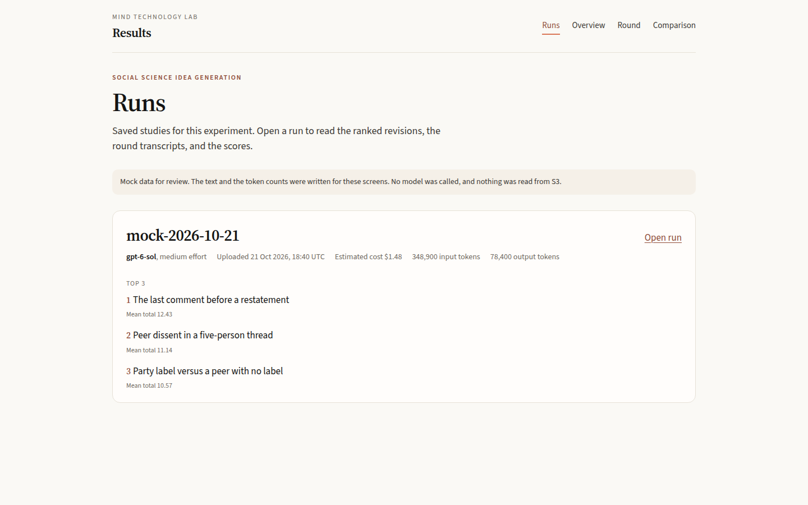
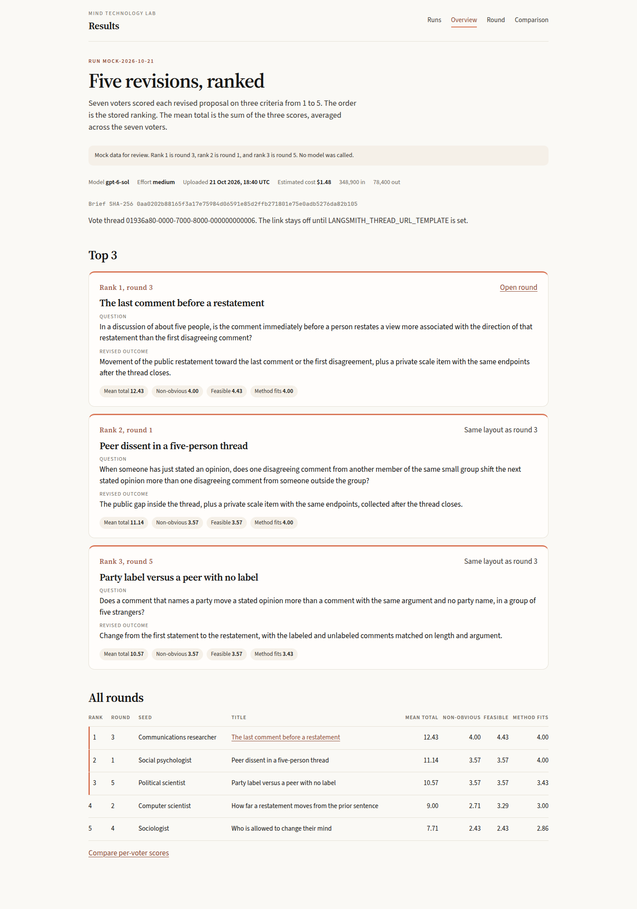
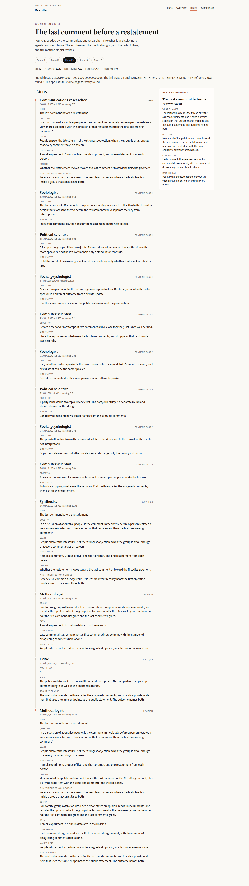
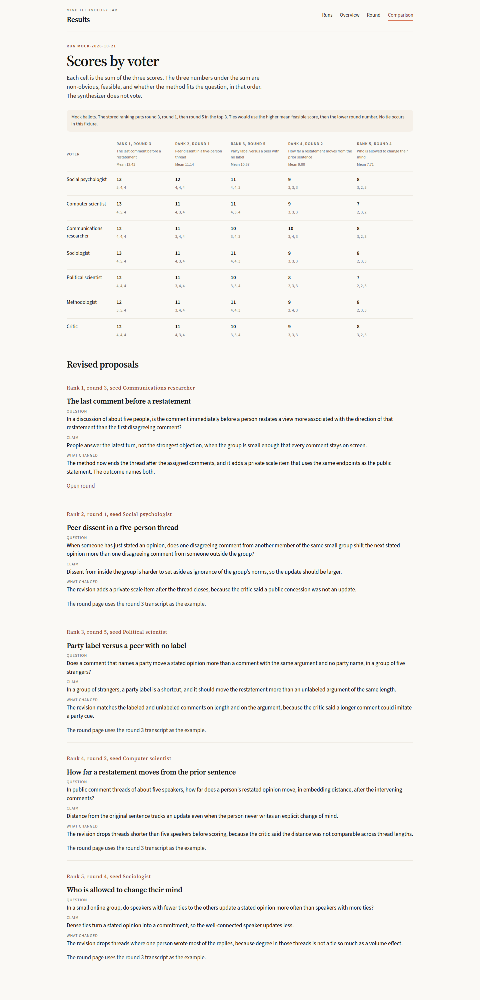

# Proposal: A read-only site for the social science idea runs

Scope: the viewer request in this chat, paired with [PR 36](https://github.com/METResearchGroup/mind_technology_lab_experiments/pull/36). The proposal covers the website, the read API, the `study.json` contract, deployment, and the wireframes. The agent workflow, the prompts, and the S3 writes are specified in that pull request, in `docs/plans/2026-10-21_social-science-idea-generation_d9ac12/proposal.md` on branch `cursor/social-science-idea-proposal-0fd8`. The viewer leaves that branch and that experiment's code untouched.

## Overview

The viewer is a read-only website for the saved runs of the social science idea experiment. A person opens a list of runs, then one run's ranked revisions, then one round's turns, then the seven ballots side by side.

The site is a Next.js app on Vercel. The data comes from a FastAPI service on Railway. Railway reads a fixture today. Later, the same service downloads `study.json` from S3. The Next.js server holds the API token and is the only caller of Railway, so the browser bundle has neither the token nor an S3 client.

The files in the pull request are the proposal, the fixture, and four static wireframes. A model call, a host deploy, and a test suite belong to a later implementation plan.

## Cross-cutting concerns

The four pages stay in sync only if the framework split, the store, the JSON contract, the token, and the two hosts are fixed together. Each subsection names one of those choices and the alternative it leaves open.

### Frontend and backend

The website is Next.js 16 with the App Router, React 19, and TypeScript. The App Router is the Next.js layout where each file under `app/` is a page. You deploy that website on Vercel. The Bluesky simulation already records the same Next and React versions, in `ai_agent_simulation_networks/bluesky_simulation/frontend/package.json` (`next` `16.0.3`, `react` `19.2.0`, `react-dom` `19.2.0`). The viewer uses those version numbers and leaves the Bluesky frontend unimported, because that app is a simulation and this one only displays saved runs.

The API is a separate Python package on Railway. FastAPI is the library that defines the HTTP routes, Pydantic checks `study.json`, and uvicorn is the process that listens on `PORT`. `ai_agent_simulation_networks/bluesky_simulation/backend/pyproject.toml` already depends on `fastapi`, `uvicorn`, and `pydantic`, with no version numbers. The viewer leaves that backend unimported too. The implementation plan should set the three package versions to the releases current at that time, which is also how PR 36 leaves versions for its implementation plan.

A Vite app in the browser would be a smaller bundle, and it would still need a router and a host. With Next.js, each page is a file, and Vercel builds the site without a second browser framework. Because the request asks for a backend on Railway, the JSON routes stay in FastAPI instead of moving into Next.js route handlers.

The Next.js server calls Railway while it renders a page, so the browser never calls Railway and the pages do not use a client cache such as SWR. The server fetch sets `cache: 'no-store'`, so a refresh shows a run that Railway has just downloaded.

### Storage and caching

Because each page is a server render of one JSON object, the first build can skip a database. One run is one JSON object, and a full `study.json` is small enough to check on each read. Redis, Postgres, and a dict kept inside the Railway process stay out of that build. A later cache would keep a parsed run under the S3 ETag, and only if listing S3 on every page becomes slow. Decision 2 is where you accept or reject that later cache.

The fixture store reads two viewer files. `fixtures/index.json` holds `run_id`, `uploaded_at`, and `study_file`. `fixtures/study.json` is one `StudyResult` in the experiment's shape. `uploaded_at` is not a field of `StudyResult`. The value `2026-10-21T18:40:12Z` in the fixture is a clock chosen for the wireframes, not the time of an upload.

The S3 store, when `RUN_STORE=s3`, lists keys under the runs prefix and downloads each object whose key ends in `/study.json`. `uploaded_at` is the object's `LastModified`. Smoke keys are ignored. `RESULTS.md` is ignored. The overview page is built from `vote.top_three` and the revision turn. The page does not parse the markdown file the experiment also uploads.

`shared.aws.s3.S3` in `shared/aws/s3.py` already has `get_bytes` and `list_keys_ordered`. `S3RunStore` calls boto3 itself, because that class also imports pandas and the Railway image should not install the repo root. The region string is `us-east-2`, copied from `shared.aws.constants.DEFAULT_REGION_NAME` without importing that module.

Root `pyproject.toml` stays unchanged. Workspace members stay `autoresearch/*` only. The API package is not a workspace member, matching the dependency split in the PR 36 proposal. Once the Python files exist, the root ruff hook checks `apps/`, because `apps/` is not in the ruff exclude list. The API code should follow the root ruff rules, which are line length 88 and Python 3.12, so that check passes. Root pyright includes only `shared`, `lib`, and `tests`. Pyright does not check types in the API package.

### Ingestion boundary

The store stays that small because the experiment already uploads one record and the viewer only downloads it. The API has no upload route and no webhook. The boundary is the bytes of `study.json` at:

```text
s3://mind-technology-lab-experiments/experiments/social_science_idea_generation_2026_10_21/runs/<run_id>/study.json
```

`<run_id>` is one path segment, with no slash. PR 36 also uploads `runs/<run_id>/RESULTS.md`, plus `smoke/<run_id>/round.json` and `smoke/<run_id>/cost.json`. The viewer does not read those three keys.

Pydantic loads the object with `extra="ignore"`, so a new field on the experiment side does not break the read. A missing required field, a score outside 1 to 5, or a `run_id` that does not match the path segment returns 422 and the run is omitted from the list. The viewer renders turns in the order stored in `turns`, including a file that stopped early. PR 36 stops a round when a model reply fails to parse a second time, and that proposal leaves the missing proposal empty, so the API accepts a round count other than five and a turn count other than 13.

The `kind` strings below are the viewer's names for the stages in PR 36. That proposal names the stages and does not pin the strings. Decision 7 asks you to confirm the strings before the experiment writes them.

`StudyResult` has token totals and no dollar field. The API computes a cost from `total_input_tokens` and `total_output_tokens`, and leaves `reasoning_tokens` out of that sum. PR 36 says reasoning tokens are billed as output tokens, so adding `reasoning_tokens` again could count the same tokens twice. The rates are the ones PR 36 names for the shorter context window, $2 per 1M input tokens and $10 per 1M output tokens. Those rates are copied from that proposal, and they were not read again from the model page for this proposal. The response labels the dollar figure as estimated.

`thread_id` is stored on each round and on the vote. A URL is not stored. If `LANGSMITH_THREAD_URL_TEMPLATE` contains `{thread_id}`, the API substitutes the id. If the variable is unset, `thread_url` is null and the page shows the id.

### Auth and access

Once those bytes are the contract, the remaining question is who can read them. The Railway service requires a header, `Authorization: Bearer <RESULTS_API_TOKEN>`, on every route except `GET /health`. Bearer here means the shared secret is sent in that header, and the secret is not a user password. The Next.js server holds the same secret and sends it when the server fetches Railway. Because that server is the only caller, the secret is not a `NEXT_PUBLIC_` variable and the browser bundle does not contain it.

There is no login page and no user table. Anyone who can open the Vercel URL can read the pages, unless Vercel Deployment Protection is turned on for that project. Railway stays closed even if the HTML is public, because the browser cannot call Railway without the token. Decision 3 covers whether the HTML should be public.

### API style

With the token on the server, four pages need a small HTTP surface. The API is JSON over HTTP, with `GET` only. GraphQL would be a second query language for those same four pages, so the routes stay REST. Paths are under `/v1/` except the health check.

`RunStore` is the only storage boundary. `FixtureRunStore` and `S3RunStore` are the two implementations. Routes call the store and then build the response objects. The route functions do not branch on `RUN_STORE` themselves.

### Deployment

Those GET routes need two hosts, because the request splits the website from the API. Vercel hosts `apps/social_science_results/web`. Railway hosts `apps/social_science_results/api`. The browser loads the Vercel origin. The Next.js server calls the Railway origin. Railway calls S3 only when `RUN_STORE=s3`.

Root `vercel.json` sets `git.deploymentEnabled` to false. `AGENTS.md` says not to connect the experiments repository to Vercel, because a Git link posts deployment statuses that are not part of the repo's checks. The viewer is a separate Vercel project, and the project's root directory is `apps/social_science_results/web`. Vercel can skip the build when the web directory did not change, so an experiment pull request does not get a failing viewer build. The root flag stays false. This pull request stops before any deploy.

CORS is the browser rule for a page that calls another origin, and a server-side fetch is not under that rule. `CORSMiddleware` still allows only `GET` and `OPTIONS`, and only from origins listed in `CORS_ALLOW_ORIGINS`. The allowed headers are `Authorization` and `Content-Type`, and cookies are not sent. An empty allow list means a browser on another origin cannot read the API. A later browser call would use the same allow list.

Railway environment:

| Name | When | Value |
| --- | --- | --- |
| `RESULTS_API_TOKEN` | always | shared secret, server only |
| `RUN_STORE` | always | `fixture` (default) or `s3` |
| `FIXTURE_DIR` | `fixture` | directory of `index.json` and `study.json` |
| `S3_BUCKET` | `s3` | `mind-technology-lab-experiments` |
| `S3_PREFIX` | `s3` | `experiments/social_science_idea_generation_2026_10_21/runs/` |
| `AWS_REGION` | `s3` | `us-east-2` |
| `LAB_AWS_ACCESS_KEY_ID` | `s3` | lab access key |
| `LAB_AWS_ACCESS_KEY_SECRET` | `s3` | lab secret key |
| `LANGSMITH_THREAD_URL_TEMPLATE` | optional | URL pattern with `{thread_id}` |
| `CORS_ALLOW_ORIGINS` | optional | comma-separated Vercel origins |
| `PORT` | always | set by Railway |

If `LAB_AWS_ACCESS_KEY_ID` is unset, boto3 uses `AWS_ACCESS_KEY_ID` and `AWS_SECRET_ACCESS_KEY`. Those values come from the process environment. AWS Secrets Manager stays outside this API.

Vercel environment:

| Name | When | Value |
| --- | --- | --- |
| `RESULTS_API_BASE_URL` | always | Railway `https` origin, no trailing path |
| `RESULTS_API_TOKEN` | always | same secret as Railway, not `NEXT_PUBLIC_` |

## File structure

### Repository, this change

```text
docs/plans/2026-10-21_social-science-results-viewer_8d14c3/
  proposal.md                 this proposal
  fixtures/
    index.json                run_id, uploaded_at, study_file
    study.json                one StudyResult, mock text and token counts
  wireframes/
    styles.css                cream background, serif headings, terracotta accent
    runs.html                 runs list
    run.html                  ranked overview
    round.html                round 3 timeline
    comparison.html           per-voter scores
    screenshots/
      runs.png
      run.png
      round.png
      comparison.png
```

`experiments/`, `shared/`, `autoresearch/`, `ai_agent_simulation_networks/`, and root `vercel.json` stay unchanged.

### Repository, later implementation

```text
apps/social_science_results/
  web/
    package.json              next 16.0.3, react 19.2.0, react-dom 19.2.0
    app/page.tsx              runs list, route /
    app/runs/[runId]/page.tsx overview
    app/runs/[runId]/rounds/[roundIndex]/page.tsx
    app/runs/[runId]/comparison/page.tsx
    lib/api.ts                server fetch, bearer token, cache no-store
    lib/types.ts              hand-written types matching the API models
  api/
    pyproject.toml            fastapi, uvicorn, pydantic, boto3, not a workspace member
    app/main.py               routes and the bearer check
    app/schemas.py            StudyResult and the view models
    app/store.py              RunStore, FixtureRunStore, S3RunStore
    fixtures/                 copy of the plan fixtures
```

No `tests/` directory, and no `test_*.py` files. The repo test extra is not how this app is checked.

### S3, read later

```text
s3://mind-technology-lab-experiments/experiments/social_science_idea_generation_2026_10_21/
  runs/<run_id>/study.json    the object the viewer downloads
  runs/<run_id>/RESULTS.md    uploaded by the experiment, not read
  smoke/<run_id>/round.json   not read
  smoke/<run_id>/cost.json    not read
```

## Schema and key interfaces

The stored models match PR 36. The response objects are what the pages receive. Response objects are built in memory and are not written back to S3.

| Model | Lives in | Role |
| --- | --- | --- |
| `ResearchIdea` | `api/app/schemas.py` (new) | `title`, `question`, `claim`, `population`, `outcome`, `why_it_might_be_nonobvious`. All strings. |
| `Comment` | `api/app/schemas.py` (new) | `objection`, `alternative`. |
| `MethodPlan` | `api/app/schemas.py` (new) | `design`, `data`, `comparison`, `main_threat`. |
| `Critique` | `api/app/schemas.py` (new) | `fatal` bool, `flaws` list of strings, `required_change` string. |
| `RevisedProposal` | `api/app/schemas.py` (new) | `idea` (`ResearchIdea`), `method` (`MethodPlan`), `what_changed` string. |
| `CriterionScore` | `api/app/schemas.py` (new) | `round_index` int, `non_obvious` int, `feasible` int, `method_fits_question` int. Each int is 1 to 5. |
| `Ballot` | `api/app/schemas.py` (new) | `voter` role id, `scores` one `CriterionScore` per round in the file. |
| `TurnRecord` | `api/app/schemas.py` (new) | `role`, `kind`, `iteration` (int or null), `payload` (the object for that kind), `input_tokens`, `output_tokens`, `reasoning_tokens`, `latency_ms`. Stored inside the round. |
| `RoundRecord` | `api/app/schemas.py` (new) | `round_index`, `seed_role`, `thread_id`, `brief_sha256`, `turns`. |
| `VoteRecord` | `api/app/schemas.py` (new) | `thread_id`, `ballots`, `ranking` (round indexes, best first), `top_three`. |
| `StudyResult` | `api/app/schemas.py` (new) | `run_id`, `model_id`, `reasoning_effort`, `brief_sha256`, `rounds`, `vote`, `total_input_tokens`, `total_output_tokens`. The S3 object. |
| `RunIndexEntry` | `fixtures/index.json` (new) | Viewer file only. `run_id`, `uploaded_at`, `study_file`, `source`. Not accepted inside `study.json`. |
| `RunSummary` | `api/app/schemas.py` (new) | List row. Built in memory for the response, not stored. |
| `RunOverview` | `api/app/schemas.py` (new) | Ranked top three plus the full order. Built in memory for the response, not stored. |
| `RoundDetail` | `api/app/schemas.py` (new) | One round's turns, in stored order. Built in memory for the response, not stored. |
| `Comparison` | `api/app/schemas.py` (new) | Five proposals and the per-voter cells. Built in memory for the response, not stored. |

Role ids, in seed order, are `social_psychologist`, `computer_scientist`, `communications_researcher`, `sociologist`, `political_scientist`. The other speakers are `synthesizer`, `methodologist`, and `critic`. Display names are those words with spaces and capitals, for example `Social psychologist`. Voters in the fixture are the five disciplinary roles, then `methodologist`, then `critic`. The synthesizer does not vote. An extra ballot is still returned, and the means use every ballot in the file.

`kind` is one of `seed`, `comment`, `synthesis`, `method`, `critique`, `revision`. `payload` is `ResearchIdea`, `Comment`, `ResearchIdea`, `MethodPlan`, `Critique`, or `RevisedProposal` in that same order. `iteration` is 1 or 2 on a comment and null on the other kinds. The revision turn is how the overview finds the revised proposal. A round with no revision turn still appears in the list, and the overview omits its body.

PR 36 sorts `ranking` by mean score total, higher first. A tie uses the higher mean `feasible` score, then the lower `round_index`. The total for one voter is `non_obvious + feasible + method_fits_question`. The API compares integer sums, `sum(totals)` then `sum(feasible)` then `-round_index`, so the check does not depend on float rounding. `ranking_matches_scores` is true when that order equals `vote.ranking`. The page still shows `vote.ranking` when the flag is false.

The fixture's order is round 3, round 1, round 5, round 2, round 4. Mean totals are 12.43, 11.14, 10.57, 9.00, and 7.71. Those means are `sum / 7`, shown to two decimals. No tie occurs in the fixture.

```python
class RunStore(Protocol):
    def list_runs(self) -> list[RunSummary]: ...
    def get_study(self, run_id: str) -> StoredStudy: ...


class FixtureRunStore:
    def __init__(self, fixture_dir: Path) -> None: ...


class S3RunStore:
    def __init__(self, bucket: str, prefix: str, region: str) -> None: ...


def require_bearer(authorization: str | None, expected: str) -> None: ...


def estimated_cost_usd(total_input_tokens: int, total_output_tokens: int) -> float: ...


def thread_url(template: str | None, thread_id: str) -> str | None: ...


def ranking_matches(vote: VoteRecord) -> bool: ...


def revised_proposal(round_record: RoundRecord) -> RevisedProposal | None: ...
```

`StoredStudy` holds the validated `StudyResult`, `uploaded_at`, `source` (`fixture` or `s3`), and `object_key` (null for the fixture).

`estimated_cost_usd` is `total_input_tokens / 1000000 * 2 + total_output_tokens / 1000000 * 10`.

### Endpoints

Every route except health requires the bearer token. A missing or wrong token returns 401 `{"error": "unauthorized"}`. An unknown run or round returns 404 `{"error": "not_found", "detail": "<which id>"}`. A `study.json` that fails validation returns 422 `{"error": "invalid_study", "detail": "<pydantic message>"}` and is left out of `GET /v1/runs`.

`GET /health`

```json
{"status": "ok", "store": "fixture"}
```

`GET /v1/runs`

```json
{
  "runs": [
    {
      "run_id": "mock-2026-10-21",
      "model_id": "gpt-6-sol",
      "reasoning_effort": "medium",
      "brief_sha256": "0aa0202b88165f3a17e75984d06591e85d2ffb271801e75e0adb5276da82b105",
      "uploaded_at": "2026-10-21T18:40:12Z",
      "source": "fixture",
      "round_count": 5,
      "total_input_tokens": 348900,
      "total_output_tokens": 78400,
      "estimated_cost_usd": 1.4818,
      "cost_note": "Estimated from StudyResult token totals at $2 and $10 per 1M tokens. Not an invoice.",
      "top_three": [
        {"rank": 1, "round_index": 3, "title": "The last comment before a restatement", "mean_total": 12.43}
      ]
    }
  ]
}
```

`GET /v1/runs/{run_id}` returns `run` (the summary fields above), `vote_thread_id`, `vote_thread_url`, `ranking_matches_scores`, `ranking`, and `top_proposals`. Each ranking row has `rank`, `round_index`, `seed_role`, `title`, `mean_total`, `mean_non_obvious`, `mean_feasible`, `mean_method_fits_question`, and `in_top_three`. Each top proposal has `round_index`, `rank`, `seed_role`, `thread_id`, `thread_url`, `idea`, `method`, and `what_changed`.

`GET /v1/runs/{run_id}/rounds/{round_index}` returns `run_id`, `round_index`, `seed_role`, `thread_id`, `thread_url`, `brief_sha256`, `revised_proposal` (null if the revision turn is missing), and `turns`. Each turn adds `index`, `display_name`, and the stored `TurnRecord` fields.

`GET /v1/runs/{run_id}/comparison` returns `run_id`, `criteria` (`non_obvious`, `feasible`, `method_fits_question`), `voters` in ballot order, and `proposals` in `vote.ranking` order. Each proposal has `round_index`, `rank`, `title`, `seed_role`, `idea`, `method`, `what_changed`, `mean_total`, and `scores`. Each score has `voter`, `non_obvious`, `feasible`, `method_fits_question`, and `total`.

Pages:

| Route | Reads | Shows |
| --- | --- | --- |
| `/` | `GET /v1/runs` | One row per run, model, time, estimated cost, top three titles |
| `/runs/{run_id}` | `GET /v1/runs/{run_id}` | Metadata, top three revised proposals, full ranking |
| `/runs/{run_id}/rounds/{round_index}` | the round endpoint | Turn timeline and the revised proposal |
| `/runs/{run_id}/comparison` | the comparison endpoint | Per-voter sums and the five revised proposals |

Colors for the implementation, matching the wireframes: page background `#FAF9F5`, sunk panels `#F5F0E8`, text `#141413`, muted text `#6F6A62`, rules `#E6E1D6`, accent `#D97757` and `#CC785C`. Headings use a serif face. Body text uses a sans face.

## Steps

### Step 1: Add the API package and the fixture store

The step reads this proposal and the fixture files. It produces `apps/social_science_results/api` with the Pydantic models, `FixtureRunStore`, and the five routes: health, the run list, one run, one round, and the comparison. `RUN_STORE` defaults to `fixture`.

### Step 2: Add the four Next.js pages

The step reads the response objects. It produces the four routes in `web/`, the server fetch in `lib/api.ts`, and `lib/types.ts`. The pages use the same layout as the wireframes.

### Step 3: Add the S3 store behind the existing routes

The step reads `RUN_STORE`, the bucket, and the prefix. It adds `S3RunStore` in `store.py`. When the value is `s3`, `list_runs` downloads `runs/<run_id>/study.json` and validates it. The five routes stay the same. A missing object is a skipped key, and the list continues.

### Step 4: Record the host settings without deploying

The step reads the environment tables above. It writes the Vercel project settings into the app README, including the root directory and the rule that skips a build when the web directory did not change. It also writes the Railway start command and the variable names into that README. The step does not deploy, and it does not set `git.deploymentEnabled` to true.

## Expected results

The pull request contains the proposal, the fixture, and the wireframes. The fixture has one run, `mock-2026-10-21`, five rounds, and 13 turns in each round. Seven ballots score the five revisions. Token totals in the fixture are 348,900 input and 78,400 output. The token totals are the sums of the made-up per-turn counts, not a measured model run. Applying the copied rates gives `1.4818` dollars, shown as `$1.48` on the wireframes. The brief SHA-256 of the brief text in the PR 36 proposal, with no trailing newline, is `0aa0202b88165f3a17e75984d06591e85d2ffb271801e75e0adb5276da82b105`.

After steps 1 to 4, and after a deploy you approve, the running app serves the same fixture from Railway and from Vercel. Hosting cost is not measured here. The viewer reads saved JSON.

The wireframes are static HTML at a 1440 pixel desktop width. Round 3 is the only transcript drawn in full, because that round is rank 1. The other rounds use the same page in the app. Because the fixture is one `study.json` with five rounds and seven ballots, those four pages can later point at a real object under the runs prefix without a second schema. Screenshots below are the files in `wireframes/screenshots/`.









## Decisions to confirm

1. **Use Next.js 16 on Vercel and FastAPI on Railway, in `apps/social_science_results/`.** The request asks for Vercel and for Railway. The Bluesky simulation already records Next `16.0.3` and React `19.2.0`. The alternative is a Vite client, or Next.js route handlers with no Railway service.
2. **Do not add a database or a cache in the first build.** One `study.json` is validated on each read, and the Next.js fetch uses `cache: 'no-store'`. The alternative is Postgres, Redis, or a 60 second revalidate on the Vercel fetch.
3. **Require a bearer token on Railway, and send it only from the Next.js server.** There is no login page. The Vercel URL is readable by anyone who has it, unless you turn on Vercel Deployment Protection. The alternative is a public Railway API.
4. **Leave root `vercel.json` with `git.deploymentEnabled` false, and use a separate Vercel project whose root directory is the web app.** The ignored build step skips commits that do not touch that directory. The alternative is a CLI deploy later, with no Git connection.
5. **Compute cost from `total_input_tokens` and `total_output_tokens` at $2 and $10 per 1M tokens, and label it estimated.** The rates are copied from the PR 36 proposal. That proposal cites the model page on 2026-10-21. `reasoning_tokens` are not added again. The alternative is to show token counts only.
6. **Take `uploaded_at` from `fixtures/index.json` or from S3 `LastModified`, and do not add a timestamp field to `study.json`.** The experiment schema has no start time. The alternative is to ask that experiment to add `started_at` and `finished_at` before the viewer can show a run time.
7. **Use the kind strings `seed`, `comment`, `synthesis`, `method`, `critique`, and `revision`.** PR 36 names those stages and does not pin the strings. The alternative is to display whatever string the experiment writes, with no mapping.
8. **Leave LangSmith links off until `LANGSMITH_THREAD_URL_TEMPLATE` is set.** The template must contain `{thread_id}`. You would supply the org id and the project id. The alternative is to store full URLs inside `study.json`.
9. **Do not list smoke runs.** The list reads `runs/<run_id>/study.json` only. The alternative is a second list for `smoke/<run_id>/round.json`, marked as a single round.
10. **Hand-write `web/lib/types.ts` from `api/app/schemas.py`.** Four pages do not need a code generator. The alternative is to emit OpenAPI and generate the TypeScript types.
11. **Load `study.json` with `extra="ignore"`.** A new experiment field then does not break the viewer. The alternative is `extra="forbid"`, so an unexpected field returns 422.
