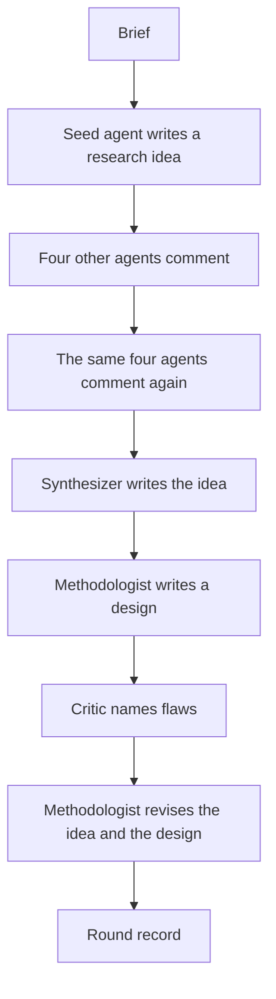
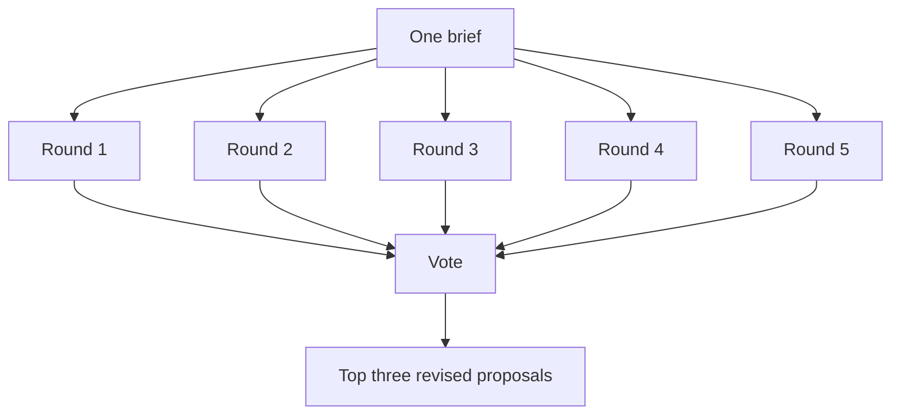
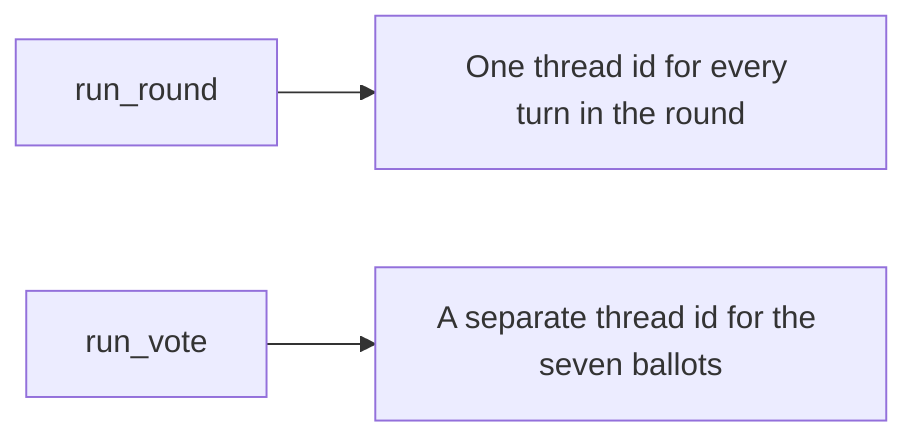

# Social science idea generation

One brief goes through a fixed discussion. Each round starts with a different discipline. The other four roles comment twice. A synthesizer, a methodologist, and a critic then produce one revised proposal. After five rounds, seven agents score the revisions and the driver keeps the top three.

The smoke run is round 1 plus a cost note. It stops before rounds 2 through 5 and before the vote.

## Round



## Five rounds



## LangSmith threads



## Smoke

From the repository root, after `src/run_smoke.py` is in place:

```bash
PYTHONPATH=/workspace:/workspace/experiments/social_science_idea_generation_2026_10_21 uv run --project experiments/social_science_idea_generation_2026_10_21 python -m src.run_smoke
```

The command writes `outputs/smoke/<run_id>/round.json` and `cost.json`, uploads both under the experiment prefix in S3, and prints `run_id` and `estimated_cost_usd`.
